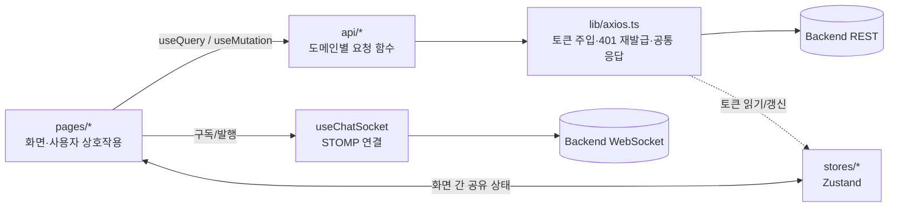

# Desserting Web

> 디저트 취향으로 사람을 만나고, 대화하고, 함께 갈 카페까지 정하는 소셜 매칭 서비스의 프론트엔드입니다.

<!-- TODO: 서비스 화면 스크린샷 또는 시연 GIF를 docs/ 폴더에 넣고 여기에 첨부 -->

- 배포 주소: https://desserting-web.vercel.app
- 백엔드 저장소: <!-- TODO: 백엔드 저장소 링크 -->

## 목차

1. [서비스 소개](#서비스-소개)
2. [주요 기능](#주요-기능)
3. [기술 스택](#기술-스택)
4. [실행 방법](#실행-방법)
5. [프로젝트 구조](#프로젝트-구조)
6. [아키텍처와 설계 결정](#아키텍처와-설계-결정)
7. [코드 작성 원칙](#코드-작성-원칙)
8. [컨벤션과 협업 방식](#컨벤션과-협업-방식)

## 서비스 소개

Desserting은 **디저트 취향**을 매개로 사람을 연결합니다. 취향이 같거나 다른 상대를 랜덤으로 추천받고, 마음에 들면 대화를 요청하고, 채팅에서 만날 카페와 시간을 제안해 예약까지 이어집니다. 현재 대구·경북 지역을 대상으로 합니다.

<!-- TODO: 팀이 정한 문제 정의를 1~2문장으로 다듬어 주세요. 예) "스펙·외모 중심의 만남 대신, 좋아하는 디저트라는 가벼운 공통점으로 첫 대화의 부담을 낮춘다." -->

> 지역을 알리는 것이 아니라, 지역에서 발견한 **가치**를 전달합니다.
> 아래는 아이디어를 발전시킨 세 가지 질문 — **WHY LOCAL → WHY PEOPLE → WHY SERVICE** — 에 대한 우리의 답입니다.

### 1. WHY LOCAL? 우리가 대구·경북을 사랑하는 이유

**대구에는 "디저트와 커피를 즐기러 가는 동네"가 있습니다.** 한 매장이 유명한 것이 아니라, 거리 전체가 하나의 목적지가 됩니다.

| 테마 거리 | 어떤 곳인가 |
| --- | --- |
| **앞산 카페거리** | 앞산네거리와 현충삼거리 사이 약 800m 양쪽으로 카페가 늘어선 거리. 2000년대 후반 형성돼 50여 개가 넘는 커피판매점이 모였고, 앞산 자락의 풍경과 이어집니다.¹ |
| **수성못** | 앞산과 함께 크고 작은 카페가 밀집한 "카페촌"으로 소개됩니다.² <!-- TODO: 수성못만의 특징(호수 산책로 등)은 별도 출처로 보강 --> |
| **동성로 카페골목** | 도심 유동인구가 많은 동성로 상권 안, 공평동 일대 골목에 카페 수십 개가 들어선 약속의 장소.¹ |

그리고 이 거리들은 우연이 아니라 도시의 카페 문화 위에 서 있습니다.

- 대구는 커피전문점이 600여 개를 넘고, 인구 대비 커피전문점 수가 전국 도시 중 가장 많다고 보도됐습니다.¹
- 대구 커피전문점 시장에서는 **지역 브랜드가 약 60%**로 대기업 브랜드(약 40%)보다 높았습니다. 프랜차이즈가 아니라 지역 사람들이 만든 가게가 거리를 채워 왔다는 뜻입니다.³
- 카페는 정해진 거리를 넘어 주택가 골목으로도 번졌고, 개성 있는 개인 카페가 들어서는 동네(예: 수성구 교수촌)도 생겼습니다.²

> ¹ 매일신문, [요즘 대구예? '마카 커피' 지예~](https://www.imaeil.com/page/view/2013112307332585217) (2013.11.23) ² 매일신문, [한적하던 교수촌 골목, 커피향이 물씬](https://www.imaeil.com/page/view/2013042707561314048) (2013.4.27) ³ YTN, [“지역 브랜드 창업, 자율성 적극 활용해야”](https://www.ytn.co.kr/_ln/0123_201710191634471185) (2017.10.19)
>
> <!-- TODO: 위 자료는 2013·2017년 기사라 오래됐습니다. 최신 통계(통계청 SGIS 생활업종, 지방행정 인허가 데이터)나 팀이 직접 답사·인터뷰한 내용으로 교체/보강해 주세요. 수성못은 위 기사에서 직접 확인되지 않아 별도 출처가 필요합니다. -->

<!-- TODO: "우리가 이 지역을 좋아하는 진짜 이유"를 팀의 경험으로 한두 문장 추가해 주세요. (예: 약속 장소를 따로 고민하지 않아도 되는 동네, 친구와 거리마다 단골 카페가 있는 일상 등) 통계보다 이 문장이 "발견한 가치"로 읽힙니다. -->
<!-- TODO: 경북 쪽 근거(경주·안동 등 디저트 거리나 전통 디저트)가 있다면 추가해 "대구·경북"을 뒷받침해 주세요. 현재 코드에서 경북은 생활권 5개로만 반영돼 있습니다. -->

이 특성은 서비스 곳곳에 그대로 반영됩니다.

| 발견한 지역의 특성 | 서비스에 반영한 방식 |
| --- | --- |
| 카페·디저트가 모인 **테마 거리** | 탐색 화면을 일반 목록이 아니라 **테마 거리 지도**(`CAFE_AREAS`: 앞산·수성못·동성로)로 구성해, 거리 단위로 매장을 고르게 했습니다. |
| 케이크·커피부터 전통 디저트까지 이어지는 디저트 문화 <!-- TODO: 근거 보강 --> | 디저트 분류 8종에 **전통 디저트**를 포함해, 취향 프로필·매장 필터에 담았습니다. |
| 생활권이 넓고 이동 거리가 만남의 변수 | 행정구역 대신 **생활권 단위**(대구 5개 권역 + 경북 5개 권역)와 **거리 반경**(10·30·50km·무제한)으로 매칭 조건을 정하게 했습니다. |

### 2. WHY PEOPLE? 그 가치는 사람들에게 왜 필요한가

<!-- TODO: 팀이 정의한 "감정적·경험적 가치"로 다듬어 주세요. 아래는 코드·서비스 흐름에서 읽은 초안입니다. -->

카페 거리에서 우리가 얻는 것은 커피가 아니라 **"좋아하는 걸 같이 즐길 사람과 편하게 마주 앉는 경험"**입니다. 취향이 겹치는 사람이 모이는 곳이라 첫 대화가 어색하지 않고, 약속 장소를 따로 고민하지 않아도 됩니다.

이 감정(**부담 없는 설렘, 같은 취향이라는 친밀감**)은 대구·경북 사람에게만 필요한 것이 아닙니다. 사진·스펙 중심의 만남이 주는 부담을 느끼는 누구에게나 필요하고, 그래서 지역을 넘어 전달할 수 있는 가치입니다.

#### 사용자 리서치

<!-- TODO: 실제로 진행한 조사를 사실대로 채워 주세요. 표본 수·방법·핵심 수치가 들어가야 "검증" 점수를 받을 수 있습니다. -->

| 조사 | 방법 / 대상 | 핵심 결과 | 서비스 반영 |
| --- | --- | --- | --- |
| <!-- 예) 설문 --> | <!-- 예) 대구·경북 20~30대 N명 --> | <!-- 예) "첫 만남 장소 정하기가 가장 부담" N% --> | <!-- 예) 채팅 내 장소 제안 기능 --> |
| <!-- 예) 인터뷰 --> | | | |

### 3. WHY SERVICE? 경험이 만들어지는 원리를 서비스로

> **"디저트는 사람을 만나는 이유가 된다."**
> 지역의 카페·디저트 경험을 *장소*가 아니라 *만남의 계기*로 재해석했습니다.

지역의 모습을 그대로 옮기는 대신, 그 경험이 **만들어지는 원리**를 뽑아 서비스로 다시 설계했습니다.

| 카페 거리에서 경험이 만들어지는 원리 | 서비스로 재설계한 방식 |
| --- | --- |
| 같은 거리에 모인 사람은 **취향이 이미 겹친다** | 거리가 없어도 만날 수 있도록 **디저트 취향**으로 상대를 추천합니다. 같은 취향(공감)과 다른 취향(새로운 발견) 중 고를 수 있습니다. |
| **가까워서** 부담 없이 만난다 | **생활권·거리 반경**(10·30·50km)으로 실제로 만날 수 있는 사람만 추천합니다. |
| 장소가 **대화의 소재**가 된다 | 대화가 시작되면 채팅 안에서 **카페·시간을 제안**하고 예약·주문까지 이어갑니다. |

<!-- TODO: 위 "원리" 3가지는 초안입니다. 팀이 실제로 관찰한 원리로 바꿔 주세요. -->

기존에는 카페가 "만나서 가는 곳"이었다면, Desserting에서는 **디저트 취향이 먼저 만나고**, 카페는 그 취향을 이어가는 **다음 단계**가 됩니다.

#### 기존 서비스와의 차별점

| 비교 항목 | 일반 소개팅·데이팅 앱 | 지도·리뷰 앱 | **Desserting** |
| --- | --- | --- | --- |
| 만남의 계기 | 사진·프로필·스펙 | 매장 정보 | **디저트 취향** (같은/다른 취향 선택) |
| 지역성 | 거리 필터 정도 | 지역 검색 | **대구·경북 생활권 + 테마 거리 지도** |
| 만남 이후 | 대화 후 직접 장소 조율 | 사람 연결 없음 | **채팅에서 장소·일정 제안 → 예약·주문까지** 한 앱에서 연결 |

#### 기술 활용

| 기술 | 사용자에게 주는 가치 |
| --- | --- |
| 위치·거리 기반 매칭 | 설정한 거리 반경·생활권 안의 상대만 추천받아 실제 만남으로 이어지기 쉽습니다. 위치로 찾지 못하면 지역 기준으로 대체됩니다. |
| STOMP(WebSocket) 실시간 채팅 | 대화 요청 수락 직후 바로 대화하고, 같은 화면에서 만날 장소·일정을 제안합니다. |
| NAVER Maps 테마 거리 지도 | 거리 경계와 매장 좌표를 한 지도에서 보며 카페를 고릅니다. |

<!-- TODO: AI를 사용했거나 계획이 있다면(예: 취향 기반 추천, 장소 추천) 여기에 사실대로 추가. 현재 프론트엔드 코드에는 AI 기능이 없습니다. -->

### 4. 비즈니스 모델

| 수익원 | 내용 | 상태 |
| --- | --- | --- |
| **하트(재화)** | 대화 요청에 쓰는 하트를 수량별 상품으로 판매 | 화면 구현 완료 (현재 모의 결제) |
| **프리미엄 패스** | 월 단위 이용권. 프리미엄 회원은 하트가 무제한으로 제공됨 (혜택 목록은 서버에서 내려줌) | 화면 구현 완료 (현재 모의 결제) |
| **제휴 매장** | 제휴 카페 노출·예약/주문 연계 수수료 <!-- TODO: 팀의 실제 계획에 맞게 수정 --> | 매장 목록·예약·주문 화면 구현 |

<!-- TODO: 원가·객단가·목표 전환율 등 지속 가능성을 뒷받침하는 숫자가 있으면 추가 -->

### 5. 전국 확장 가능성 (대구·경북을 벗어나도 누릴 수 있는 가치)

앞서 정리한 원리(취향이 겹치는 사람 + 가까운 거리 + 장소가 주는 대화 소재)는 대구의 카페 거리에만 있는 것이 아닙니다. 지역 정보는 로직이 아니라 **데이터로 분리**되어 있어, 다른 지역을 추가할 때 코드 구조를 바꿀 필요가 적습니다.

| 지역 의존 요소 | 위치 | 확장 시 할 일 |
| --- | --- | --- |
| 지역·생활권 | `stores/matchingStore.ts`의 `REGIONS`, `LIVING_AREAS` | 새 지역 데이터 추가 |
| 카페 테마 거리 | `pages/explore/cafeAreas.ts`의 `CAFE_AREAS` | 지역별 거리 목록 추가 |
| 지도 기본 위치 | `pages/explore/cafeMapCamera.ts`의 `DAEGU_DEFAULT_CAMERA` | 지역 선택에 따라 카메라 전환 (현재 대구 고정) |
| 디저트 분류 | `lib/dessert.ts` | 공통 분류 유지, 지역 특색 항목만 추가 |

"그 지역의 디저트 거리 + 그 지역 사람" 구조는 부산 서면·전주 한옥마을처럼 지역마다 뚜렷한 디저트 거리가 있는 곳에 그대로 적용할 수 있습니다. <!-- TODO: 확장 우선순위 지역과 이유가 있으면 추가 -->

## 주요 기능

| 영역      | 설명                                                                              |
| --------- | --------------------------------------------------------------------------------- |
| 회원가입  | 이메일 가입 → 관심 디저트 선택 → 프로필 입력의 단계별 플로우                      |
| 매칭      | 같은 취향 / 다른 취향 중 선택해 랜덤 후보 카드를 받고, 좋아요·대화 요청을 보냄    |
| 채팅      | 대화 요청 수락·거절, STOMP(WebSocket) 기반 실시간 채팅, 장소·일정 제안            |
| 카페 탐색 | NAVER 지도의 테마거리 위에서 매장을 탐색하고 메뉴 조회·주문·예약                  |
| 제휴 매장 | 매장 목록과 내 위치 기준 거리 표시, 상세 정보                                     |
| 마이페이지 | 프로필 수정, 하트(재화) 구매, 프리미엄 패스, 주문 내역                          |

## 기술 스택

| 구분            | 사용 기술                            |
| --------------- | ------------------------------------ |
| 프레임워크      | React 19, TypeScript, Vite           |
| 스타일링        | Tailwind CSS 4, shadcn/ui (Radix UI) |
| 라우팅          | React Router                         |
| 서버 상태       | TanStack Query, Axios                |
| 클라이언트 상태 | Zustand                              |
| 폼·검증         | React Hook Form, Zod                 |
| 실시간 통신     | STOMP (WebSocket)                    |
| 지도            | NAVER Maps JavaScript SDK            |
| 코드 품질       | ESLint, Prettier, GitHub Actions CI  |
| 배포            | Vercel                               |

## 실행 방법

### 요구 사항

- Node.js 24 (CI와 동일한 버전)
- npm
- 백엔드 서버 (기본값 `http://localhost:8080`)

### 설치 및 실행

```bash
# 저장소 클론
git clone https://github.com/Desserting/Desserting-web.git
cd Desserting-web

# 의존성 설치
npm ci

# 개발 서버 실행
npm run dev
```

### 환경 변수

`.env.development`에서 개발 환경 변수를 관리합니다. 개인 환경에서만 값을 바꾸려면 `.env.development.local`을 만들어 사용하세요. `*.local` 파일은 Git에 올라가지 않습니다.

| 변수                       | 필수 | 설명                                                            |
| -------------------------- | ---- | --------------------------------------------------------------- |
| `VITE_API_BASE_URL`        | O    | 백엔드 API 기본 주소. 개발 환경 기본값은 Vite 프록시용 `/api`   |
| `VITE_NAVER_MAP_CLIENT_ID` | 지도 | NAVER Maps Client ID. 없으면 지도 화면에 안내와 재시도 버튼 표시 |

```dotenv
# .env.development.local
VITE_NAVER_MAP_CLIENT_ID=발급받은_Client_ID
```

### 개발 서버 프록시

`vite.config.ts`에서 다음 경로를 `http://localhost:8080`으로 프록시합니다. 개발 중에는 CORS 설정 없이 백엔드와 통신할 수 있습니다.

- `/api`: REST API
- `/ws`: WebSocket

### 스크립트

| 명령어            | 설명                                            |
| ----------------- | ----------------------------------------------- |
| `npm run dev`     | 개발 서버 실행                                  |
| `npm run build`   | 타입 검사 후 프로덕션 빌드                      |
| `npm run preview` | 빌드 결과물을 로컬에서 미리보기                 |
| `npm run lint`    | ESLint 검사                                     |
| `npm run gen:api` | 백엔드 OpenAPI 명세로 `src/types/api.d.ts` 생성 |

`gen:api`는 백엔드 서버가 `http://localhost:8080`에서 실행 중이어야 합니다.

<details>
<summary><b>NAVER 지도 설정 / 배포 환경 설정</b></summary>

#### NAVER 지도 Client ID 발급

1. [네이버 클라우드 콘솔](https://console.ncloud.com/)에서 **Application Services → Maps → Application**을 등록하고 **Dynamic Map**을 선택합니다.
2. Web 서비스 URL에 `http://localhost`, `http://127.0.0.1`, `https://desserting-web.vercel.app` 등 실제 사용하는 호스트를 등록합니다. (포트와 경로는 제외, Preview 주소도 쓸 경우 별도 등록)
3. 발급받은 **Client ID**를 `.env.development.local`과 Vercel 환경변수의 `VITE_NAVER_MAP_CLIENT_ID`에 설정합니다. **Client Secret은 프론트에 넣지 않습니다.**
4. 개발 서버를 재시작하고 Vercel은 다시 배포합니다.

SDK는 `ncpKeyId`로 로드합니다. 하단 탭이 있는 화면에서 SDK를 미리 준비하고, 실제 지도는 탐색 화면에서 생성합니다.

공식 문서: [Client ID 발급](https://navermaps.github.io/maps.js.en/docs/tutorial-1-Getting-Client-ID.html), [SDK 로드](https://navermaps.github.io/maps.js.en/docs/tutorial-2-Getting-Started.html), [Web 서비스 URL 등록](https://www.ncloud.com/support/faq/all/1047?searchKeyword=map)

#### Vercel 배포

개발 환경의 `/api`는 Vite 개발 서버 프록시용이라 배포 환경에서는 쓸 수 없습니다. Vercel 프로젝트의 환경 변수에 `VITE_API_BASE_URL`을 백엔드 전체 주소(예: `https://{백엔드 호스트}/api`)로 설정하세요. 실시간 채팅 주소는 이 값의 호스트를 기준으로 `wss://{백엔드 호스트}/ws`로 만들어집니다.

</details>

## 프로젝트 구조

화면(`pages`)은 **기능 단위 폴더**로 나누고, 서버 통신(`api`)·전역 상태(`stores`)·공용 코드(`components`, `lib`)는 역할별로 분리했습니다.

```
src
├── api                  # 서버 통신. 도메인(auth, chat, matching ...)별 파일 + 응답 타입
├── components           # 여러 화면이 함께 쓰는 공용 컴포넌트
│   └── ui               # shadcn/ui 기반 기본 UI 요소 (Button, Dialog, Input ...)
├── lib                  # 특정 화면에 속하지 않는 유틸 (axios 인스턴스, 날짜, 지도 SDK 로더)
├── pages                # 라우트 단위 화면. 기능별 폴더로 묶고, 그 기능에서만 쓰는 코드는 같은 폴더에 둠
│   ├── chat             #   채팅방·대화 요청 + useChatSocket(STOMP 연결 훅)
│   ├── explore          #   카페 지도·메뉴·주문·예약 + 지도 카메라/라벨 로직
│   ├── home / login / signup / matching / profile / stores / my / notifications
├── stores               # Zustand 전역 상태 (auth, matching, signup, cafe, notification)
├── App.tsx              # 라우트 정의
└── main.tsx             # QueryClient·Router 설정과 앱 진입점
```

`@` 별칭은 `src` 디렉터리를 가리킵니다. (예: `import { Button } from '@/components/ui/button'`)

UI 컴포넌트는 shadcn CLI로 추가합니다.

```bash
npx shadcn@latest add <component>
```

## 아키텍처와 설계 결정

### 계층과 데이터 흐름



화면은 서버 주소·헤더·토큰 같은 통신 세부사항을 모르고, `api/*`의 함수와 타입만 사용합니다.

### 주요 설계 결정

| 결정                           | 이유                                                                                                                                                                   |
| ------------------------------ | ---------------------------------------------------------------------------------------------------------------------------------------------------------------------- |
| **서버 상태 / 클라이언트 상태 분리** | 서버에서 온 데이터는 TanStack Query(캐싱·재시도), 화면 간 공유가 필요한 클라이언트 값(로그인 토큰, 가입 진행 상태, 매칭 조건)은 Zustand로 나눠 역할이 섞이지 않게 했습니다. |
| **API 계층 분리**              | 요청 함수와 응답 타입을 `api/<도메인>.ts`에 모아, 엔드포인트가 바뀌어도 수정 범위가 한 파일로 제한됩니다. 백엔드 OpenAPI 명세로 타입을 생성(`npm run gen:api`)해 명세와 어긋나는 것을 빌드에서 잡습니다. |
| **인증 처리를 axios 인터셉터에 집중** | 요청마다 토큰을 붙이고, 401이면 토큰을 재발급해 원 요청을 한 번만 재시도합니다. 동시에 여러 요청이 만료돼도 재발급 요청은 하나로 합쳐지고, 실패하면 로그아웃 처리합니다. |
| **에러는 HTTP 상태가 아닌 에러 코드로 분기** | 백엔드 공통 응답(`ApiResponse` / `ApiErrorBody`)의 `code`를 `getApiError`로 꺼내 쓰므로 화면마다 에러 파싱 로직이 중복되지 않습니다.                                  |
| **실시간 연결을 커스텀 훅으로 캡슐화** | `useChatSocket`이 STOMP 연결·구독·재연결·토큰 갱신을 담당하고, 채팅 화면은 `onMessage` 콜백과 연결 상태만 다룹니다.                                              |
| **기능 단위 폴더 + 코로케이션** | 한 기능에서만 쓰는 컴포넌트·훅·상수(예: `explore/cafeMapCamera.ts`, `chat/MessageItem.tsx`)는 해당 `pages/<기능>/` 안에 두어, 기능을 추가·삭제할 때 영향 범위가 폴더 안에 머뭅니다. |
| **외부 SDK 지연 로딩**         | NAVER Maps SDK는 `lib/naverMaps.ts`의 TanStack Query 옵션으로 필요할 때 로드하고, 키 누락·로딩 실패 시 재시도 UI를 보여줍니다.                                                                  |
| **서버 코드 ↔ 화면 문구 매핑을 한곳에**  | 디저트 종류 같은 서버 코드값은 `lib/dessert.ts`에서 화면용 이름으로 변환하고, 모르는 코드는 원문을 그대로 보여줘 서버가 값을 추가해도 화면이 깨지지 않습니다.              |

## 코드 작성 원칙

- **이름으로 의도를 드러냅니다.** 컴포넌트·페이지는 `PascalCase`(`ChatRoomPage`), 훅은 `use` 접두사(`useChatSocket`), 서버 연동 타입은 도메인 용어(`RandomCandidate`, `ApiErrorBody`)를 그대로 씁니다.
- **주석은 "무엇"이 아니라 "왜"를 적습니다.** 코드만으로 알기 어려운 서버 규칙·예외 처리 이유를 JSDoc/한 줄 주석으로 남깁니다. (예: 토큰 재발급을 한 번만 보내는 이유, `canRequest`가 false인 경우의 의미)
- **한 파일은 한 가지 책임만 갖습니다.** 화면이 커지면 하위 컴포넌트·훅·순수 함수 파일로 분리합니다. (`ChatRoomPage` → `MessageItem`, `PlaceProposalSheet`, `useChatSocket`)
- **타입으로 계약을 표현합니다.** `noUnusedLocals`/`noUnusedParameters` 등 TypeScript 검사를 켜고(`npm run build`에서 `tsc -b` 수행), 서버 응답은 인터페이스로 정의합니다.
- **스타일은 도구가 통일합니다.** Prettier(세미콜론, 작은따옴표, Tailwind 클래스 정렬)와 ESLint(React Hooks 규칙 포함)를 사용합니다.

## 컨벤션과 협업 방식

### 커밋 컨벤션

커밋 메시지는 `type: 한글 설명` 형식을 사용합니다.

| type     | 설명                                  |
| -------- | ------------------------------------- |
| feat     | 새로운 기능 추가                      |
| fix      | 버그 수정                             |
| docs     | 문서 수정                             |
| style    | 코드 포맷팅 등 로직 변경이 없는 수정  |
| refactor | 기능 변경이 없는 코드 개선과 리팩터링 |
| test     | 테스트 코드 추가·수정                 |
| chore    | 빌드 설정, 패키지 관리 등 기타 변경   |
| ci       | CI/CD 설정 변경                       |
| merge    | 브랜치 병합 (PR 번호 포함)            |

예시: `feat: 시작 화면 버튼 컴포넌트 추가`, `fix: API 요청 baseURL 누락 수정`, `merge: 회원가입 플로우 추가 #12`

### 브랜치 컨벤션

작업 브랜치는 `type/작업내용` 형식을 사용하며, 작업 내용은 영문 소문자와 하이픈으로 작성합니다.

| 브랜치       | 설명                            |
| ------------ | ------------------------------- |
| `main`       | 배포 가능한 안정 버전           |
| `feature/*`  | 기능 개발                       |
| `refactor/*` | 코드 리팩터링                   |
| `test/*`     | 테스트 코드 추가·보강           |
| `chore/*`    | 빌드 설정과 의존성 등 기타 변경 |
| `ci/*`       | CI/CD 설정 변경                 |

예시: `feature/add-start-page`, `refactor/split-axios-instance`, `ci/add-lint-step`

### 협업 방식

1. `main`에서 브랜치 컨벤션에 맞게 작업 브랜치를 만듭니다.
2. 커밋 컨벤션에 맞춰 작업 내용을 커밋합니다. 커밋 전에 `npm run lint`를 실행합니다.
3. `main`을 대상으로 Pull Request를 작성합니다. PR 템플릿의 체크리스트를 확인해주세요.
4. PR을 올리면 CI(`npm ci` → `npm run build`)가 자동으로 실행됩니다. 빌드가 실패하면 원인을 해결한 뒤 다시 푸시해주세요.
5. 기본적으로 스스로 검토하되, 필요시 리뷰 요청 및 승인 후 머지합니다.
